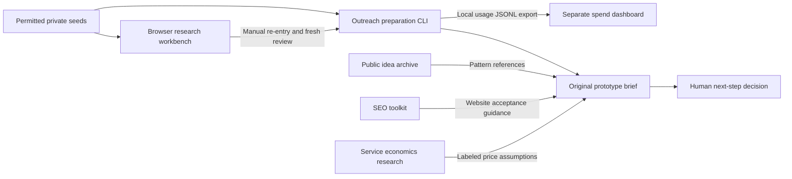

# System responsibilities and integration boundaries

This describes the reviewed source projects, not applications copied into this repository. See [exact heads and validation](../status/source-projects.md). All five PRs remain separate drafts at the handoff snapshot.

Arrows describe manual/reference relationships. They do not imply automatic data synchronization, live APIs or permission to contact a prospect.

## Who owns what

| Component | Responsibility | Boundary |
|---|---|---|
| Idea archive | Public references, review methods, source metrics, original briefs and clusters | No real prospect records; no completed customer demos |
| Business research workbench | Browser UI for permitted CSV/JSON intake, identity, presence/health evidence, qualification and scoped offers | Local browser storage and private exports; analyst attestations are not independent truth |
| Outreach-Engine | ICP/batches, identity/deduplication, evidence, review gates, trusted profiles, resumable local tasks, suppression, outcomes and usage exports | Python standard library, CLI, local SQLite; no external providers or communications |
| SEO toolkit | Framework, source register, report/schema, search research and website acceptance | Read-only/planning outputs; no client audit or live policy changes |
| Pricing research | Market observations and scenario model | Historical sources and assumptions, not a quote or accounting system |
| Spend dashboard | Imported/manual ledger, estimates, unknowns, budgets and scenarios | No live billing or enforced spending cap; browser QA gaps remain |
| This repository | Curated strategy, decisions, source inventory and handoff | No duplicate app, contact database or autonomous campaign |

## Profiles and state

The engine implements trusted `catalog-discovery-v1` and `local-service-inquiry-v1` profiles. ICPs select a built-in ID and provide ordinary criteria; they cannot import executable policy or disable shared gates. Version-1 ICPs without a profile retain the catalog default. More audit families require reviewed code and tests.

Candidate revisions and the complete ICP/profile/shared-policy fingerprint bind human decisions. Old approvals without a matching fingerprint require review again. Agent-origin and legacy-unspecified evidence cannot satisfy gates; synthetic evidence is limited to synthetic records. The browser workbench has not acquired the engine's profile implementation simply because both describe the same future direction.

The engine supports local transactions, idempotent reimports, conservative deduplication, visible conflicts, resumable preparation and safe CSV exports. This is not an authenticated multitenant backend. SQLite is unencrypted, the owner is trusted, and suppression is workspace-local. A local user/program with database access can bypass UI/CLI constraints; future model or team execution needs isolated approval authority and secure storage.

## Manual workbench bridge

The browser snapshot carries calendar dates, evidence and historical attestations. Its summary CSV is not a sufficient engine intake contract. Map source IDs privately; resolve identity and source rights; preserve conflicts and date precision; collect fresh observations and actual UTC timestamps where the engine requires them; then perform new reviews. Do not fabricate midnight timestamps or import approval flags.

There is no automatic snapshot adapter. A future one should output pending suggestions and exceptions, never approvals. The [reviewed contract](https://github.com/NateKeola/Dogfood/blob/c33eb2122fafe787ed65619bf4dcde2bc6fa7b7c/projects/outreach-engine/docs/INTEGRATION.md) documents this mapping. Creating a private export remains subject to the user's download explanation preference.

## Minimum provider plan

| Need | Default | Optional later service and unresolved requirement |
|---|---|---|
| Company seeds | Permitted existing local files / official source subsets | Exa after exact endpoint, terms, account quota and budget review |
| Site behavior | Human, rendered public-page task checks | Browser adapter after network/access/security and cost review |
| Public business route | Official contact page and mainline | Apollo only for a justified licensed professional-contact gap; search and enrichment differ |
| Email verification | Not needed for a calling-first preparation pilot | Hunter if later justified; email hold still applies |
| System of record | Existing private local workflow | Approved private CRM after needs, roles and suppression requirements are known |
| Search/video research | Curated source-linked outputs | Ahrefs/vidIQ only if a specific licensed data gap justifies them |
| Calling | Human preparation only | No dialer, phone number, voice API or mailbox provisioned |

All external adapters remain disabled. An assistant connector is not an application credential or account entitlement. No keys, paid providers, subscriptions or billing connections were enabled by this handoff. The prior registry pilot is a separate bounded manual source read, not an engine provider run.

Useful workflows can be reproduced without claiming Ahrefs' backlink/keyword index or vidIQ's historical platform coverage. Keep output format, observed sample coverage and proprietary datasets separate. The [dated integration research](https://github.com/NateKeola/Dogfood/blob/c33eb2122fafe787ed65619bf4dcde2bc6fa7b7c/projects/outreach-engine/docs/INTEGRATIONS.md) contains historical pricing and quotas; recheck before use.

Future network adapters need public-target checks through redirects, private/loopback/metadata blocking, bounded time/size/query limits, no credential forwarding and safe handling of denied/rate-limited/uncertain requests. Imported source text cannot activate tools. The existing URL metadata validator is not a complete network security implementation.
