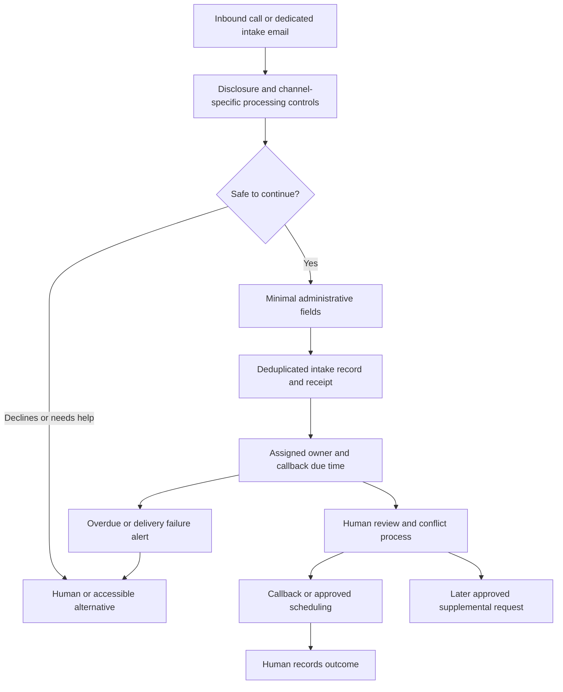

# MVP tiers and system design

Proposed on 2026-11-03. Nothing in this file is implemented or connected. See [legal constraints](legal-and-security.md) and [validation](validation-plan.md).

## Choose the smallest useful tier

| Tier | Scope | Added burden | Recommendation |
|---|---|---|---|
| 0 — configure existing intake | Audit routing, staff ownership, existing forms/CRM, callback queue and basic acknowledgements | Firm-approved scripts, data permissions and operational measurement | First discovery and implementation option |
| 1 — callback-first voice + email | Inbound handling, minimal fields, contact read-back, approved acknowledgement, callback request or approved slot, one review queue | Consent, vendor review, scoped mailbox/telephony access, retries, security and human fallback | Preferred bounded pilot hypothesis after approval |
| 2 — guided factual intake | Practice-specific questions and narrow supplementary requests after firm clearance | More sensitive information, conflict workflow, language/quality review and tighter access | Only after Tier 1 shows value and counsel approves |
| 3 — document intake | Authorized upload links and document inventory; extraction for human review | Malware isolation, storage, retention, identity/access and factual accuracy | Defer; no attachments in first pilot |

Autonomous merits evaluation, legal advice, engagement decisions and self-directed legal action are outside these tiers. A “qualified lead” should mean **administratively routed for review under documented criteria**, never a legal determination or a representation promise.

## Minimum information contract

| Field | Why / when | Limitation |
|---|---|---|
| Preferred name and callback number or email | Arrange contact | Read back or confirm destination; do not call this identity verification |
| Safe contact method, callback window, time zone, voicemail permission | Avoid missed contact and unintended disclosure | No substantive details in message preview, voicemail or calendar title |
| New inquiry versus existing-client/other caller | Route to the correct staffed path | Do not reveal whether a named person is a client |
| High-level service category and relevant state/location | Administrative routing | Broad categories and “unsure” allowed; no legal classification claim |
| Relevant party names | Only counsel-approved minimal conflict-screen inputs | No full dispute narrative; no automatic match clearance |
| Self-reported deadline/urgent situation | Immediate human escalation | Record the user's wording and supplied date; never calculate limitations or promise timeliness |
| Language/accessibility preference | Make handoff usable | Route to qualified support; do not fabricate translation competence |
| Consent event, source channel, receipt time, owner and status | Accountability | Separate consent to processing from marketing/outbound permission |

Do not solicit SSNs, full DOB, payment information, financial/medical records, immigration documents, credentials, litigation files or a detailed story in Tier 1. If someone volunteers sensitive material, restrict it and alert the authorized reviewer; a prompt saying “do not share” cannot guarantee prevention.

## Workflow

An incoming email may already contain confidential text or attachments before any warning can be shown. Ingest into an approved restricted mailbox; do not forward its full contents to a model by default. Start with metadata/minimal extraction only after policy approval, quarantine attachments and send no substantive response without the approved boundary. Ignore autoresponder loops, bounces and duplicate deliveries. Proposed automation is not permission to send any email during this research.

For calls, prove the disclosure/consent sequence happens before the relevant recording/transcription/AI processing. If the selected vendor cannot support the firm's required sequence or an adequate alternative, do not enable that flow. A recording toggle alone is not sufficient evidence. Review transfers and third-party speech/model streams.

## Use the existing firm system as the first portal

One intake item should display: received time/channel, minimal contact details, source/uncertainty per field, consent status, urgency flag, conflict status **pending human review**, assigned person, callback due time, last attempt, outcome and restricted-document indicator. Make missing values explicit. Preserve corrections and audit events. Summaries should be grounded in the actual supplied information and labeled AI-assisted when applicable.

Suggested states: `received → needs_review → callback_assigned → callback_attempted → consultation_scheduled → human_closed`. Keep `delivery_failed`, `needs_accessible_help`, `consent_declined`, `urgent_review` and `restricted_material` as explicit exception flags. A closed record needs a human-selected reason; automated dismissal is excluded.

A new custom portal is justified only if authorized buyer evidence shows the existing CRM cannot support the required work. Its design would need authenticated user access, tenant boundaries, roles, restricted pre-conflict queues, auditability, export/deletion/hold controls and no public case URLs. None of these are implemented by this research.

## Integration and reliability boundaries

- One firm, one practice scope, one inbox, one calendar and one CRM first. No historical mailbox ingestion or source-application migration.
- Store a stable channel event ID; make retries idempotent. Tentative identity matching based on phone/email needs staff resolution for shared households or conflicting identities. Never merge different matters solely by a matching address.
- Keep API credentials server-side and scoped. Check revoked access, webhook signatures, rate limits, expired tokens, duplicate delivery, CRM downtime and calendar contention.
- A booking is confirmed only after the calendar write succeeds; an intake receipt is not a confirmed appointment. Reconcile every failed write into a visible queue. Keep sensitive detail out of calendar invites.
- Use deterministic routing and approved wording where possible. Treat all caller/email/document content as untrusted data; it cannot authorize new tools, recipients, permissions or policy changes.
- Use feature-level disable switches and an independent human fallback. Spending controls must specify actual provider enforcement; an app budget alert is not a hard cap.

## Human ownership and boundaries

Firm lawyer: conflicts, legal criteria, retention, disclosure and acceptance decisions. Intake manager: staffing, callback windows, overdue queue, factual corrections and outcomes. Service operator: configuration, delivery reliability, scoped access, incidents and measured costs. Vendors: contracted processing responsibilities, never the firm's legal judgment.

Urgency handling must be approved in advance. Immediate danger gets a fixed appropriate emergency-service direction; legal urgency gets a staffed escalation path and a clear statement that no deadline is extended or protected by the intake. If no staff are available, acknowledge that limitation rather than implying someone is monitoring. Existing clients and represented parties route to a separate approved process. Human availability must be priced, scheduled and tested, not assumed.
